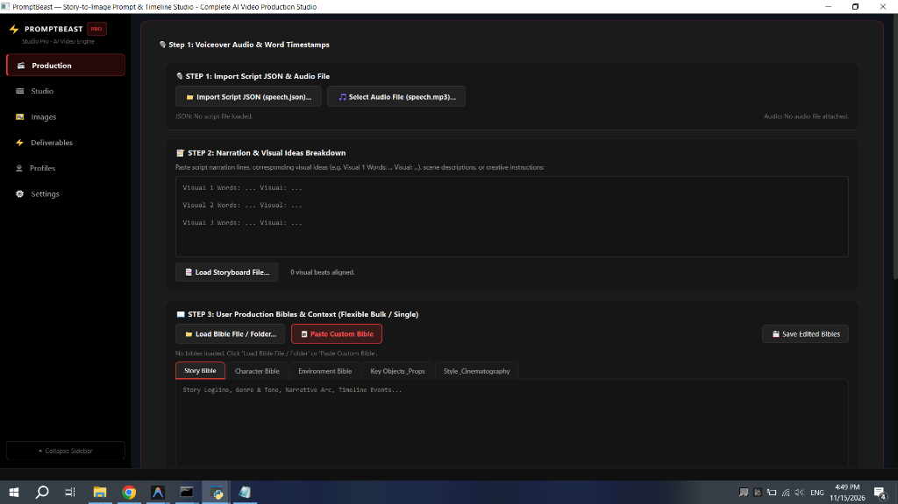
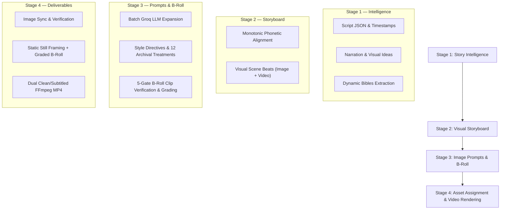

# Vidroa (PromptBeast Studio Pro) ⚡
### *Narration-Aware Image Prompt Generation, Stock B-Roll & Story-to-Video Studio*

[](https://www.python.org/)
[-red.svg)](https://wiki.qt.io/Qt_for_Python)
[](https://groq.com/)
[](https://ffmpeg.org/)
[](LICENSE)

---

### 🖥️ Application UI Layout & Production Studio



*Vidroa Production Studio — Featuring FrameForge-inspired Cinematic Red & Black styling, sub-second phonetic alignment, live visual style presets with copy-ready master prompts, B-roll stock video integration, and native FFmpeg video synthesis.*

---

**Vidroa** (powered by PromptBeast) is a production desktop application designed to transform spoken voiceover audio, script JSON, and visual breakdowns into production-ready image generation prompts and curated stock B-roll video scenes, synchronize every scene with sub-second timestamps, and compile clean and subtitled final videos locally.

```
Import Audio & Script JSON ➔ Provide Narration & Visual Ideas ➔ Extract Dynamic Bibles ➔ Generate Prompts & B-Roll Clips ➔ Assign Assets ➔ Local Video Render (FFmpeg)
```

---

## 📑 Table of Contents
1. [Core Features](#-core-features)
2. [Streamlined 4-Stage Production Pipeline](#-streamlined-4-stage-production-pipeline)
3. [The 4 Visual Art Styles](#-the-4-visual-art-styles)
4. [Master AI Prompts for External LLMs](#-master-ai-prompts-for-external-llms)
5. [Interactive Three-Stage Conversational Protocol](#-interactive-three-stage-conversational-protocol)
6. [Parameters Guide: Strict Rules vs. Tolerance](#-parameters-guide-strict-rules-vs-tolerance)
7. [Groq Multi-Key Pooling & Rate-Limit Rotation](#-groq-multi-key-pooling--rate-limit-rotation)
8. [Installation & Setup](#-installation--setup)
9. [Quick Launch](#-quick-launch)

---

## ⚡ Core Features

- **FrameForge Red & Black Aesthetic**: Professional cinematic dark theme (`#101010` canvas, `#E53935` accents, clean neutral panels) with responsive layouts.
- **Dynamic Spoken Word Karaoke Zoom**: Subtitles automatically zoom the currently spoken word to 150% (`{\fscx150\fscy150}`) in sync with narration, matching the high-retention Hormozi / MrBeast video editing standard.
- **Two-File Clean & Subtitled Export**: Renders `{project}_nosubtitles.mp4` (completely clean) and burns ASS subtitles in a fast second pass to `{project}_subtitles.mp4`, with a render-panel checkbox to select your active output.
- **B-Roll Video Scene Support & Still Protection**: Automatically routes `VIDEO of ... KEYWORDS ...` scenes through stock search, 5-gate quality verification (4.0s–10.0s, ≥720p, brightness, motion, tag match), and style color grading, while keeping all still images held completely still with zero zoom or pan.
- **Random Cinematic Transitions**: Built-in dynamic transitions between scenes (Dip to Black, Soft Dissolve / Crossfade, Soft Flash) that maintain 100% frame-perfect audio and subtitle synchronization.
- **Single Bulk Prompt Export**: Exports all scene prompts in a single bulk batch (no artificial 100-item splits), prefixed with two/three-digit numbering (`01 `, `02 `, ... `137 `) for instant batch image generation.
- **Bidirectional Asset Ingestion**: Drop or select your voiceover audio (`speech.mp3`) and Vidroa automatically auto-detects and pairs matching word-level timestamp JSON (`speech.json`) in the same directory.
- **Instant Monotonic Phonetic Alignment**: Paste natural storyboard lines (e.g. `Visual 1 Words: ... Visual: ...`). Robust anchor-based sequence alignment guarantees boundary safety across hundreds of scenes.
- **Multi-Key Groq Pooling**: Rotates multiple Groq API keys automatically with real-time rate limit tracking (HTTP 429), exponential cooldowns, and batch recovery.
- **Local FFmpeg Video Compilation**: Zero external GPU or cloud rendering dependencies for video output. Assembles static still images, B-roll video clips, audio, transitions, and animated karaoke subtitles into upload-ready MP4s.

---

## 🏗️ Streamlined 4-Stage Production Pipeline



1. **Stage 1 — Story Intelligence**: Establishes Character Bibles, Environment Bibles, Key Props, and Visual Continuity Rules.
2. **Stage 2 — Visual Storyboard**: Maps narration sentences to concrete visual descriptions and synchronizes audio timestamps.
3. **Stage 3 — Image Prompts & B-Roll**: Expands image scenes into camera-ready prompts adhering strictly to the active visual style, and fetches, gates, and grades B-roll video clips for `VIDEO` scenes.
4. **Stage 4 — Asset Assignment & Video Rendering**: Binds images/videos to scenes and compiles both clean and subtitled videos locally using native FFmpeg.

---

## 🎨 The 4 Visual Art Styles

All live visual styles are dynamically loaded from `config/visual_styles/*.json`:

| Style ID | Style Name | Visual Category | Key Visual Rules & Locks |
| :--- | :--- | :--- | :--- |
| `zombie_survival` | **Zombie Survival** | 2D Animation / Survival | Pure flat 2D cartoon, heavy black `#1A1A1A` outlines. Locked hero narrator (backwards red cap `#D63A2A`, charcoal hoodie `#333333`, white shirt, brown strap). Uniform olive-green zombie horde (`#8A9A66` skin, white eyes, jagged teeth, tattered brown jackets `#5C4033`). Zero blood/gore. |
| `whatif_flat_vector` | **What-If Flat Vector** | 2D Vector | Minimalist black stick figure with **strictly locked bright RED hoodie (`#FF0000`)** across all scenes, uniform limb thickness. Midnight navy night-world (`#12182E`, `#0A0E17`) with localized warm golden light pools. Zero gradients. |
| `century_old_photograph` | **Century-Old Photograph** | Historical Archival | Authentic damaged archival print featuring 12 specialized archival image treatments (Woodblock/Engraving Split, Leporello Folder, Silver Bleeding, Fold Creases, Diptych Split, Document Archive, Split-Screen Trio, Textured Blur, Antique Map Overlay, Full Antique Engraving Plate, Full-Frame Authentic Archival Photograph, Full Historical Map Plate). Strictly zero modern RGB colors. |
| `3d_red_blue_stickman` | **3D Red & Blue Stickman** | 3D Animation | Stylized 3D CGI toy universe. Strict faction separation: Attackers/Invaders = 100% Solid Bright Red; Defenders = 100% Solid Blue. Featureless spherical heads, rounded 3D block geometry. |

---

## 🤖 Master AI Prompts for External LLMs

Located in `config/ai_prompts/`, each live visual style has a dedicated prompt file:
- `01_zombie_survival_ai_prompt.txt`
- `02_whatif_flat_vector_ai_prompt.txt`
- `03_century_old_photograph_ai_prompt.txt`
- `05_3d_red_blue_stickman_ai_prompt.txt`

In the desktop app, clicking **`📋 Copy Master AI Prompt`** immediately copies the prompt for your active visual style to your clipboard.

---

## 💬 Interactive Three-Stage Conversational Protocol

Every prompt enforces this streamlined interaction:

1. **Stage 1 (Prompt)**: You send ONLY the Master Prompt to ChatGPT, Claude, or Gemini.  
   *AI replies ONLY:* `"I am ready. Please provide your story script or narration transcript, and I will generate your optimized visual storyboard."`
2. **Stage 2 (Script)**: You paste your raw story script.  
   *AI replies:* Chronological visual storyboard in exact `Visual X Words: ... Visual: ...` format, followed by: `"Storyboard complete! Reply with 'Generate Bibles' to receive your complete Production Bibles."`
3. **Stage 3 (Bibles)**: You reply `"Generate Bibles"`.  
   *AI replies:* Complete 7-Part Production Bibles (Characters, Environments, Props, Style, Chronology, Rules).

---

## 📐 Parameters Guide: Strict Rules vs. Tolerance

### What You MUST Follow:
- **Format Tag**: `Visual [N] Words: <spoken script words> Visual: <physical visual description>` (or `Visual: VIDEO of <shot description> KEYWORDS <comma-separated keywords>` for B-roll).
- **Chronological Sequence**: Narration must follow the natural order of your audio from start to finish.
- **100% Script Coverage**: Every spoken line must be assigned to a visual beat.
- **Concrete Visuals**: Describe what the camera actually sees (subjects, action, lighting, shot framing).
- **Style Integrity**: Obey the style's character lock, faction colors, and negative constraints.

### What You Can Safely IGNORE (Handled Automatically):
- **Prefix Labels**: `Visual 1`, `Scene 1`, `Shot 1`, or `1.` are all parsed interchangeably.
- **Letter Case**: `Words:` vs `words:`, `Visual:` vs `visual:` are case-insensitive.
- **Numbers vs. Words**: Variations like `"60"` vs `"sixty"` or `"8:47 PM"` vs `"8 .47 pm"` are automatically synchronized by the phonetic sequence aligner.
- **Timestamps**: **Do NOT write timestamps in your AI output.** Vidroa automatically reads exact millisecond timestamps from your audio's `speech.json`.
- **Model Codes**: **Do NOT write `--ar 16:9` or Midjourney flags.** Model parameters are attached automatically.
- **Spacing**: Single or double line breaks between visual beats are both handled cleanly.

---

## 🔑 Groq Multi-Key Pooling & Rate-Limit Rotation

Create a file named `groq api.txt` in the project root (see `groq api.example.txt` for format) and paste your Groq API keys (one per line, starting with `gsk_`):

```text
gsk_example_key_1
gsk_example_key_2
gsk_example_key_3
```

PromptBeast's `GroqMultiKeyManager`:
1. Distributes requests across all available keys.
2. Automatically detects HTTP 429 rate limits, reads Groq's `retry-after` header, and temporarily cools down the limited key.
3. Switches immediately to the next ready key so batch generation continues without interruption.

---

## 💻 Installation & Setup

### Prerequisites
- **Python 3.10+** (Python 3.11 or 3.12 recommended)
- **FFmpeg** installed and added to system `PATH` (verify via `ffmpeg -version`)

### 1. Clone the Repository
```bash
git clone https://github.com/mianshahid-official/Vidroa.git
cd Vidroa
```

### 2. Set Up Virtual Environment (Recommended)
```bash
python -m venv venv
# On Windows:
venv\Scripts\activate
# On macOS/Linux:
source venv/bin/activate
```

### 3. Install Dependencies
```bash
pip install -r requirements.txt
```

### 4. Configure API Keys
Copy `groq api.example.txt` to `groq api.txt` and add your Groq API keys:
```bash
copy "groq api.example.txt" "groq api.txt"
```

---

## 🚀 Quick Launch

### Windows One-Click:
Double-click `run.bat` or run:
```bash
run.bat
```

### Cross-Platform Terminal:
```bash
python app/main.py
```

### Run Automated Tests:
```bash
pytest tests/
```

---

## 📄 License
This project is licensed under the MIT License — see the [LICENSE](LICENSE) file for details.
