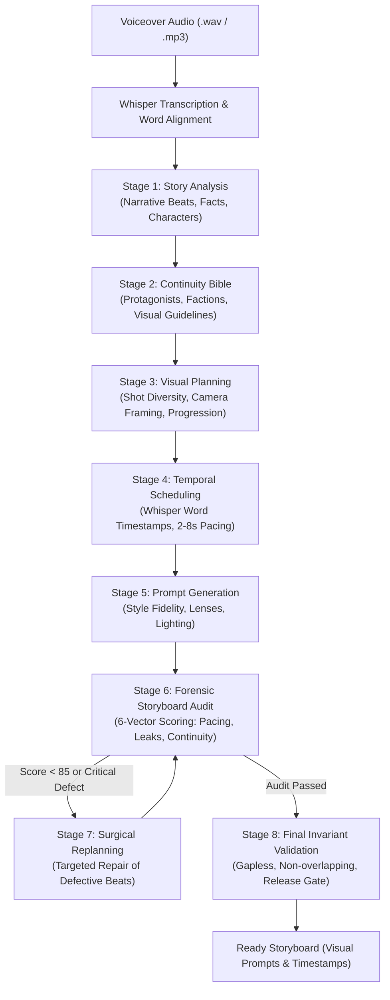

# PromptBeast Desktop Studio Pro ⚡
### *Next-Generation Story-to-Video AI Production Studio*

**PromptBeast Desktop Studio Pro** is a high-performance desktop workstation designed to transform spoken voiceover audio narrations into complete cinematic videos. It combines an **8-Stage AI Storyboard Planning Pipeline**, **Faster-Whisper Word-Level Timeline Synchronization**, **Automated Multi-Criterion Forensic Quality Auditing**, and an **FFmpeg Video Rendering Engine** with dynamic animated karaoke subtitles.

Built with a modern obsidian and neon glassmorphism UI (`#080D14` canvas, `#A6FF00` interactive focal points, and `#10B981` status indicators), PromptBeast is engineered for creators running high-retention video channels on YouTube, Shorts, TikTok, and Instagram Reels.

---

## 📑 Table of Contents
1. [Key Features](#-key-features)
2. [Complete 8-Stage Production Pipeline](#-complete-8-stage-production-pipeline)
3. [Visual Style Presets](#-visual-style-presets)
4. [Audio-First Ingestion & Whisper Alignment](#-audio-first-ingestion--whisper-alignment)
5. [Automatic Project Creation](#-automatic-project-creation)
6. [Application Interface & Workflow](#-application-interface--workflow)
7. [Local-First Workspace Architecture](#-local-first-workspace-architecture)
8. [Installation & Setup](#-installation--setup)
9. [Configuration & Groq Multi-Key Pooling](#-configuration--groq-multi-key-pooling)
10. [Running the Application](#-running-the-application)

---

## ⚡ Key Features

- **Audio-First Ingestion**: Start directly with any voiceover audio file (`.wav`, `.mp3`, `.m4a`). No manual script typing needed.
- **Auto-Project Creation**: Automatically transcribes your audio, extracts the first few spoken words, appends the current date & time, and provisions the project workspace folder in `./projects/`.
- **Sub-Second Word-Level Synchronization**: Uses `faster-whisper` and Groq Whisper Cloud to align every spoken token to exact millisecond timestamps.
- **8-Stage Storyboard Pipeline**: Automated story decomposition, character continuity bible, visual beat planning, audio word-timestamp scheduling, cinematic prompt generation, forensic audit, surgical replanning, and release gate invariant validation.
- **Deterministic Release Gate**: Zero timeline gaps, zero negative overlaps, zero duplicate boundary words, and pacing enforcement (target: 2.0s–8.0s per visual scene, flexible up to 10.5s for natural unbroken spoken clauses).
- **Multi-Key Groq API Pooling**: Rotates multiple Groq API keys automatically with intelligent rate-limit tracking, exponential backoff, and JSON repair parser for Qwen 2.5 / GPT-OSS models.
- **Streamlined Scene Sync**: 1-click AI auto-pacing maps generated images across narration timestamps with interactive audio scrubbing and cut point fine-tuning.
- **Dynamic Animated Karaoke Captions**: Hardcodes high-retention animated subtitles with custom fonts, colors, glowing highlights, and customizable placement.
- **Deliverables & Mobile Phone Share**: One-click MP4 compilation, YouTube 1080p viral thumbnail generator with expanded prompt preview, and a built-in local Wi-Fi QR code server for mobile downloads.
- **100% Self-Contained Local Workspace**: All project state, audio files, images, video renders, and browser profiles are saved strictly within the repository workspace (`./projects/` and `./data/`).

---

## 🏗️ Complete 8-Stage Production Pipeline

PromptBeast's planning backend runs as an automated 8-stage sequence to guarantee narrative progression, character consistency, and acoustic alignment:



### Stage Breakdown
1. **Stage 1 — Story Analysis (`Stage1Analyzer`)**:
   - Parses the spoken transcript to extract core narrative beats, setting contexts, chronological progression, and historical claims.
2. **Stage 2 — Continuity Bible (`Stage2ContinuityManager` / `Stage2Planner`)**:
   - Establishes persistent character and faction profiles (e.g. primary protagonist vs secondary factions, costume details, signature colors). Prevents character drifting across scenes.
3. **Stage 3 — Visual Planning (`Stage3VisualPlanner`)**:
   - Maps story beats into diverse shot categories: wide establishing shots, dynamic medium action framing, extreme macro close-ups, and dramatic low-angle perspectives.
4. **Stage 4 — Temporal Scheduling (`Stage4TemporalScheduler`)**:
   - Integrates narration audio timestamps with sentence cadence.
   - Enforces contiguous timeline coverage: gapless ($<0.15\text{s}$), non-overlapping, with 2.0s–8.0s target pacing ceiling (allows natural spoken sentences up to 10.5s without artificial mid-word cutting).
5. **Stage 5 — Prompt Generation (`Stage5PromptGenerator`)**:
   - Generates production-ready Midjourney/Ideogram `/imagine prompt:` syntax for each visual beat.
   - Strictly enforces the user-selected visual style preset with zero benchmark contamination.
   - Injects camera lenses (35mm, 50mm f/1.4, 85mm anamorphic), lighting (cinematic chiaroscuro, volumetric haze, aged albumen sepia), and subject composition.
6. **Stage 6 — Forensic Storyboard Audit (`Stage6StoryboardAuditor`)**:
   - Performs automated, mathematical multi-criterion quality audit:
     - Narration Alignment (25%)
     - Visual Continuity (20%)
     - Visual Variety & Anti-Repetition (15%)
     - Temporal Pacing (15%)
     - Prompt Integrity & Detail (15%)
     - Visual Style Fidelity (10%)
   - Flags style leaks, prompt scaffolding remnants, or boundary repetition.
7. **Stage 7 — Automated Replanning & Surgical Repair (`Stage7Replanner`)**:
   - Surgically repairs any defective scenes flagged by Stage 6.
   - Rewrites visual subjects and prompts while maintaining absolute timeline continuity and style compliance.
8. **Stage 8 — Storyboard Invariant Validation & Release Gate (`Stage8FinalValidator`)**:
   - Programmatically verifies all mathematical invariants: zero timeline gaps, zero negative overlaps, zero duplicate boundary words, valid word provenance.
   - Validates that every scene is ready for production image generation.

---

## 🎨 Visual Art Style Guide & Custom Presets

PromptBeast's visual art styles are defined as modular JSON documents located in `config/visual_styles/<style_id>.json` and rendered as responsive studio cards in the application.

### Visual Style Guide JSON Schema
Each visual art style adheres to the following specification:

```json
{
  "id": "bw_vintage_historical_photography",
  "name": "Black & White Vintage Historical Photography",
  "category": "Historical & Archival",
  "description": "An authentic black-and-white historical documentary photography aesthetic with realistic human anatomy, accurate historical clothing, natural monochrome grayscale tonal variation, and subtle archival film grain.",
  "system_instructions": "An authentic black-and-white historical documentary photography aesthetic. Every image should resemble a genuine photograph captured using historical photographic equipment and preserved in an archival collection.\n\nHuman subjects: Represent humans as realistic photographic subjects with natural anatomy...\n\nLighting, shadows, and camera lens...\n\nAvoid: Colorization, 3D rendering, cartoon aesthetics.",
  "is_custom": false
}
```

#### Schema Fields:
- **`id`** (`str`): Unique identifier (e.g., `century_old_photograph`, `custom_cyberpunk_anime`).
- **`name`** (`str`): Human-readable display title displayed on the studio card.
- **`category`** (`str`): Grouping category tag (e.g., `Historical & Archival`, `3D Animation`, `Artistic`, `Cinematic`, `Custom`).
- **`description`** (`str`): Short 1–2 sentence overview displayed in UI tooltips and metadata.
- **`system_instructions`** (`str`): Master AI prompt instructions injected into Groq LLM during Stage 5 prompt generation. Dictates human anatomy, camera lenses, lighting, textures, materials, and negative anti-realism constraints.
- **`is_custom`** (`bool`): `true` for user-created custom styles, `false` for official protected built-in styles.

#### Card Preview Thumbnail:
- Optional 16:9 thumbnail previews are stored at `assets/style_previews/<style_id>.png` (or `.jpg`).
- If no image is provided, the card renders a sleek dark studio gradient with a category badge and art palette icon.

---

### Built-in Presets Matrix

| Preset Identifier | Display Name | Visual Characteristics | Best Used For |
|:---|:---|:---|:---|
| `century_old_photograph` | **Century-Old Photograph** | Authentic 1900s silver-gelatin archival photograph, heavy sepia grain, daguerreotype texture, historical realism. | Ancient history, military campaigns, classical documentaries. |
| `3d_red_blue_stickman` | **3D Red & Blue Stickman** | Fully stylized 3D matte render; protagonist in solid red, secondary characters in solid cobalt blue. Clean isometric lighting. | Explainer videos, high-retention viral storytelling, tactical reenactments. |
| `bw_vintage_historical_photography` | **B&W Vintage Photography** | Deep monochrome chiaroscuro, wet-plate collodion emulsion, high tonal contrast, authentic archival scratches. | 19th/20th-century historical dramas, investigative documentaries. |
| `paper_quilling` | **Paper Quilling Illustration** | Intricate coiled and rolled paper strips, tactile depth, studio softbox lighting, vibrant layered papercraft art. | Mythology, folklore, artistic cultural explainers. |
| `mixed_media_collage` | **Mixed-Media Collage** | Ripped newsprint textures, vintage postage stamps, ink splatters, gouache brushstrokes, layered archival paper. | Biographies, mystery cases, investigative narratives. |
| `paper_cutout` | **Paper-Cutout Illustration** | Multi-plane shadowbox layers, sharp silhouette edges, backlighting, craft paper textures. | Children's tales, allegories, storybook histories. |

---

### Creating & Managing Custom Art Styles

PromptBeast provides full visual style authoring directly in the UI:
1. **Adding a New Style**:
   - Click **➕ Add Custom Style** in the header or click the **➕ Add Custom Art Style** card at the end of the rack.
   - Enter your **Style Name**, select or enter a **Category**, provide a **Description**, and write your **AI System Prompt Instructions** (or click **⚡ Insert Template Guide**).
   - Click **📂 Choose Thumbnail Image...** to attach a custom 16:9 preview artwork.
   - Click **💾 Save Visual Style**. The style is immediately saved to disk, loaded into memory, and appears as a visual card in the studio.
2. **Duplicating an Existing Style**:
   - Open **⚙️ Manage Styles**, select any built-in preset, and click **📋 Duplicate as Custom Style** to use it as a base template.
3. **Deleting Custom Styles**:
   - Hover over any custom style card in the studio matrix and click the **✕** delete button in the top corner (with confirmation prompt).
   - Alternatively, open **⚙️ Manage Styles**, select the custom style, and click **🗑 Delete Custom Style**.
   - *Note*: Built-in system styles are protected against accidental deletion.

---

## 🎙️ Audio-First Ingestion & Whisper Alignment

### 1. Direct Voiceover Ingestion
- Ingest voiceover tracks in `.wav`, `.mp3`, `.m4a`, or `.flac`.
- Includes an integrated waveform player with instant play/pause and millisecond seeking.
- Self-TTS models have been completely removed, streamlining startup time and freeing over 1 GB of disk space.

### 2. Dual-Engine Whisper Transcription & Live Script Viewer
- **Groq Whisper Cloud (v3-turbo)**: Transcribes long audio tracks with word-level timestamps in ~2 seconds.
- **Local Faster-Whisper (Offline)**: 100% offline fallback running on your local CPU.
- **Interactive Script Viewer**: Immediately upon transcription completion (or timestamp import), a formatted transcript container appears showing:
  - Full transcribed narration text with soft-wrap and smooth scrolling.
  - Word count badge (e.g. `1,321 words`) and total audio duration badge (e.g. `08:43`).
  - **📋 Copy Text** button for 1-click clipboard copying.
  - **▲ Collapse / ▼ Expand** toggle button.

---

## 📁 Automatic Project Creation

No manual project names or manual folder setups:
1. Select your voiceover audio file.
2. The Whisper engine transcribes the audio and extracts the opening words.
3. The system generates a clean project folder name (e.g. `In_330_BC_the_greatest_20261107_2048`).
4. Automatically provisions:
   ```
   projects/<Project_Name>/
   ├── audio/           # Auto-copied voiceover audio track
   ├── images/          # Target folder for generated scene visuals
   ├── renders/         # Rendered MP4 videos & thumbnails
   └── project.json     # Saved project state and timestamps
   ```
5. Displays the active project name in the top bar indicator.

---

## 🖥️ Application Interface & Workflow

The user interface features a uniform, undivided sidebar navigation:

```
[01 Production] ➔ [02 Studio] ➔ [03 Scene Sync] ➔ [04 Deliverables] ➔ [05 Profiles] ➔ [Settings]
```

### 1. 01 Production
- **Audio Ingestion Card**: Load voiceover audio, scrub playback, choose between Groq Whisper or Local Faster-Whisper, and 1-click transcribe word timestamps. Zero inner scrolling.
- **Visual Style Selector**: Select your visual style preset with high-resolution preview cards.
- **Aspect Ratio**: Choose between Landscape (`16:9` for YouTube), Portrait (`9:16` for Shorts/TikTok), or Square (`1:1`).
- **AI Engine Status**: Real-time ping and availability indicator for pooled Groq LLM keys.

### 2. 02 Studio
- **Planned Scenes Matrix**: Inspect each generated scene with its exact timecode (`00:00.00 – 00:05.78`), duration badge, and shot category (`CINEMATIC`, `WIDE`, `CLOSE-UP`).
- **Prompt Inspector**: View and edit the `/imagine prompt:` for every scene.
- **Bulk Export**:
  - `Copy All Prompts`: Copies every prompt to clipboard formatted for bulk image generation tools.
  - `Copy Prompt`: 1-click clipboard copy for individual scenes.
  - `Export...`: Exports full JSON timeline or prompt text files.

### 3. 03 Scene Sync
- **Streamlined Pacing Studio**: Minimalist action bar focusing on the primary `⚡ AI Auto-Place & Pace Images Across Timeline` engine.
- **Waveform Scrubbing**: Play audio segments directly matching each scene's narration excerpt.
- **Image Drag-and-Drop**: Easily drop generated `.png` or `.jpg` images directly into scene slots.

### 4. 04 Deliverables
- **Video Compilation**: Compiles synchronized images and narration audio into high-quality MP4 using FFmpeg.
- **Dynamic Karaoke Captions**: Hardcodes word-by-word highlighted subtitles with custom fonts, colors, and positioning.
- **YouTube Viral Thumbnail Studio**: Generates high-CTR thumbnail prompts with an expanded, comfortable preview box that is never cut off.
- **Wi-Fi Mobile Phone Share**: Spawns an internal HTTP server on port `10246` with a scannable QR code to preview and download finished videos directly on your phone.

### 5. 05 Profiles
- **Multi-Account Browser Manager**: Manages up to 6 isolated Chrome profiles (`acc1`–`acc6`) for automated image generation workflows with independent cookies and session persistence.

---

## 📁 Local-First Workspace Architecture

PromptBeast enforces a local-first workspace structure. **No project files or temporary caches are written to the C: drive user profile.**

```
D:\AntiGravity\PromptBeast\
├── app/                        # Desktop GUI (PySide6) and UI components
│   ├── ai/                     # Groq LLM client, job worker, parallel workers
│   ├── config/                 # Application settings & environment loaders
│   ├── core/                   # Whisper aligner, browser profiles manager
│   ├── models/                 # Pydantic data models (Project, Scene, Timeline)
│   └── ui/                     # Qt windows, dialogs, panels, and custom widgets
├── backend/                    # Core 8-Stage Planning Pipeline
│   ├── config.py               # Backend runtime & model configuration
│   ├── inference/              # Inference engine wrappers & JSON repair
│   └── pipeline/               # Stages 1 through 8 implementation modules
├── config/                     # Pipeline & system configuration files
├── data/                       # Local runtime data
│   └── browser_profiles/       # Isolated browser sessions (acc1..acc6)
├── presets/                    # Visual style presets (presets.json)
├── projects/                   # 100% self-contained user projects directory
│   └── <Project_Name>/         # Individual project workspace
│       ├── audio/              # Narration voiceover WAV & alignment JSON
│       ├── images/             # Generated scene images (001.png, 002.png...)
│       ├── renders/            # Final compiled MP4 videos & thumbnails
│       └── project.json        # Complete project state & storyboard timeline
├── groq api.txt                # Multi-key Groq API key pool
├── requirements.txt            # Production Python runtime dependencies
├── run.bat                     # 1-Click Windows launch script
└── README.md                   # System documentation
```

---

## 🚀 Installation & Setup

### Prerequisites
- **Operating System**: Windows 10 or Windows 11 (64-bit)
- **Python**: Python 3.10 through Python 3.14
- **FFmpeg**: Installed and available in system `PATH` (or bundled via Qt/FFmpeg)

### Step 1: Install Dependencies
Open PowerShell or Command Prompt in the repository folder:
```powershell
pip install -r requirements.txt
```

### Step 2: Configure Groq API Keys
Add your Groq API keys to `groq api.txt` in the root folder, one key per line:
```
gsk_xxxxxxxxxxxxxxxxxxxxxxxxxxxxxxxxxxxxxxxxxxxxxxxx
gsk_yyyyyyyyyyyyyyyyyyyyyyyyyyyyyyyyyyyyyyyyyyyyyyyy
```

---

## 🎬 Running the Application

### Method 1: Using 1-Click Launch Script
Double-click `run.bat` in the project root:
```bat
run.bat
```

### Method 2: Command Line
```powershell
python -m app.main
```
